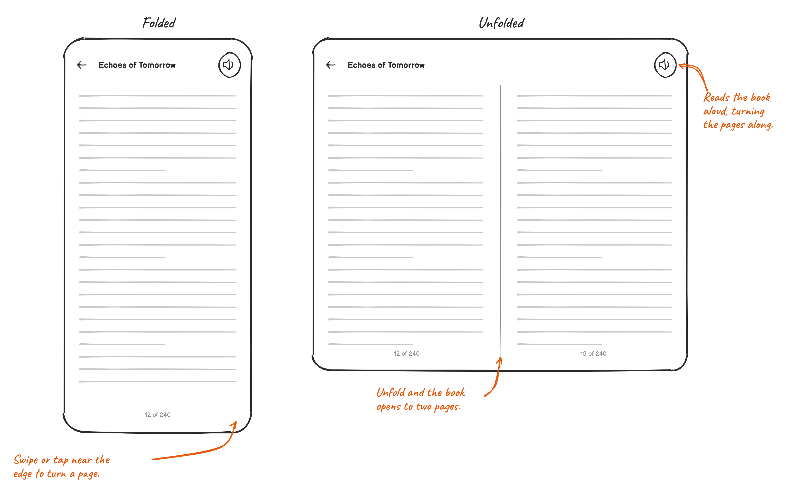

# Pageturner

**A clean audiobook player and ebook reader for Android, built to be reliable and a joy to use.**

Pageturner is based on [Voice](https://github.com/PaulWoitaschek/Voice) by Paul Woitaschek.

Pageturner turns your own audiobook files into a calm, focused listening library. It remembers where you stopped, keeps playback controls close, and includes the audiobook-specific details that generic music players miss: chapter navigation, sleep timer, bookmarks, playback speed, silence skipping, and auto-rewind after pauses.

Pageturner also reads your EPUB and PDF books, and can read them aloud. On a foldable, a book opens to two pages side by side when you unfold it.

  
  
  

## Why Pageturner?

- **Made for your files:** Add a folder once and Pageturner organizes your local M4B, MP3, M4A, OGG, OGA, and OPUS audiobooks.
- **Built for listening:** Resume positions, bookmarks, sleep timer fade-out, volume boost, speed control, and Android Auto support are part of the core experience.
- **Reads your ebooks too:** EPUB and PDF files in your folders sit next to your audiobooks, with their covers. Turn pages like paper, jump through the table of contents, see two pages side by side on an unfolded foldable, or have them read aloud.
- **Private and uncluttered:** No account, no ads, no forced cloud sync. Your library stays on your device.

## Ebooks

  

This is a sketch of the reader. See [Ebooks](docs/ebooks.md) for how it works.

## Download

Install the newest build on your phone from [app-free-debug.apk](https://github.com/frankt86/Voice/releases/download/debug/app-free-debug.apk). It installs next to Voice from Google Play or F-Droid and leaves its library alone.

## Learn more

The [docs](docs/index.md) cover features, how to organize your library, [ebooks](docs/ebooks.md), and the FAQ.

## Contributing

To find your way around the code, start with [Development](docs/development.md) and [Architecture](docs/architecture.md).

## Support Voice

Pageturner is built on Voice. Voice has no ads, no investors and no company behind it. It's made by one developer and kept going by its listeners. Monthly support is what lets me plan the next release, not just the next fix. Ko-fi needs no account:

Or [sponsor monthly on GitHub](https://github.com/sponsors/PaulWoitaschek). A one-time tip helps too.

## License

Pageturner, like Voice, is licensed under [GNU GPLv3](LICENSE.md). By contributing, you agree to license your code under the same terms.
