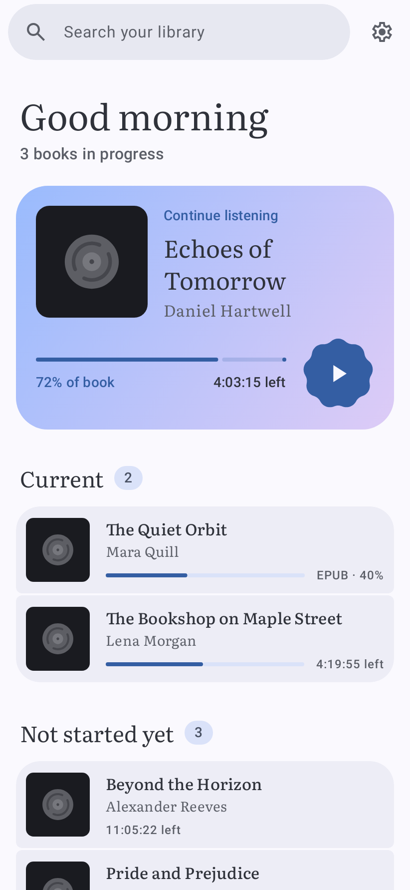
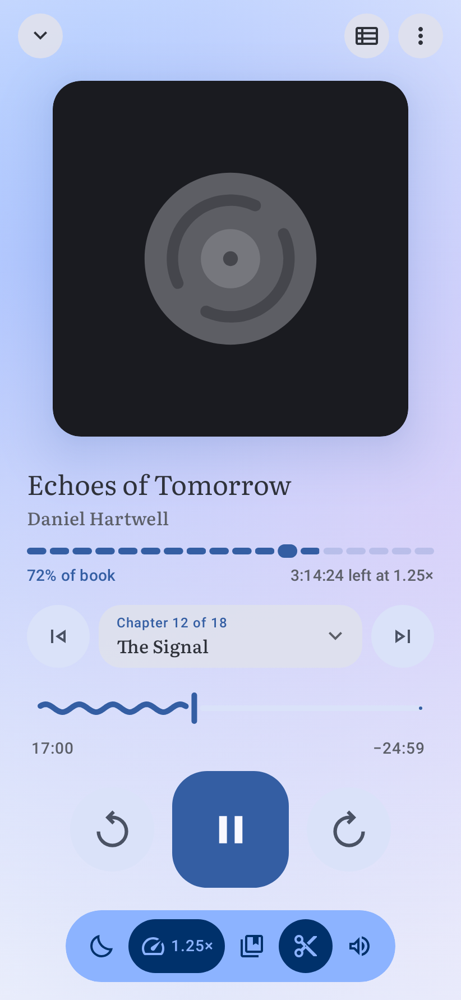
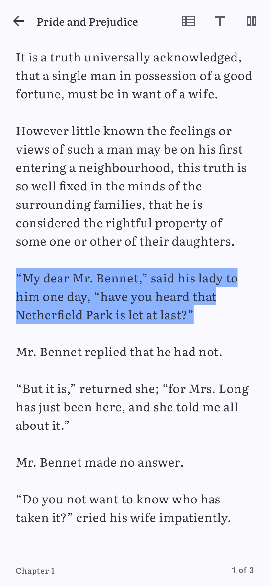
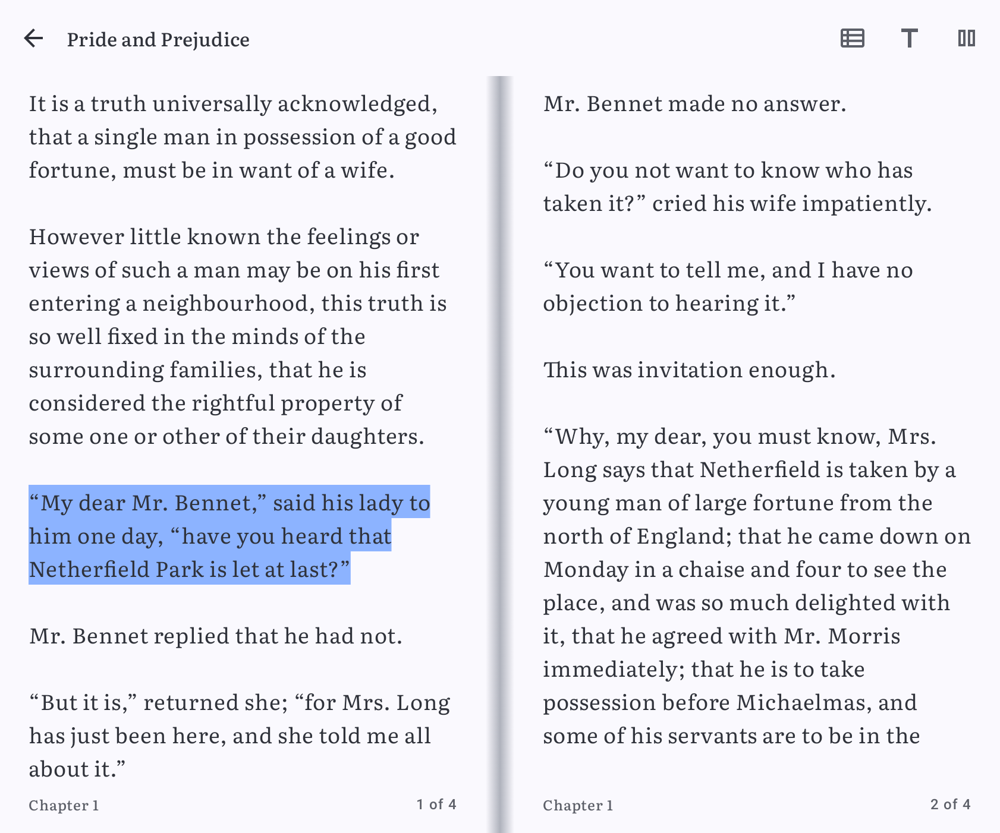

# Pageturner

**An audiobook player and ebook reader for Android.**

Pageturner plays your audiobooks, reads your EPUB, PDF and Kindle books, reads them aloud in a natural voice, and
downloads books from OPDS catalogs, Komga and Audiobookshelf. It is a fork of
[Voice](https://github.com/PaulWoitaschek/Voice) by Paul Woitaschek and merges the updates of Voice.

## Download

- **[Download pageturner.apk](https://frankt86.github.io/Pageturner/pageturner.apk)**: the latest stable release,
  signed with the release key. Open the link on your phone, open the file and tap **Install**.
- **[GitHub Releases](https://github.com/frankt86/Pageturner/releases/latest)**: the same APK, with the release notes.
- **[Obtainium](https://obtainium.imranr.dev/)**: add `https://github.com/frankt86/Pageturner` to get each update.
- **[Test build](https://frankt86.github.io/Pageturner/pageturner-debug.apk)**: built from every change. It can have
  bugs.

The stable app (`io.github.frankt86.pageturner`) and the test app are two different apps. They install side by side, and
next to Voice from Google Play or F-Droid. Each one keeps its own library. [Install](docs/install.md) gives the steps.

Pageturner needs Android 9 or newer.

  
  
  

## Features

### Audiobooks

- Add a folder once, and Pageturner finds your M4B, MP3, M4A, OGG, OGA and OPUS audiobooks. See
  [Organizing Audiobooks](docs/organizing.md).
- Resume where you stopped. Chapters, bookmarks, a sleep timer with fade-out, playback speed, skip silence, volume boost
  and a short rewind after a pause.
- Android Auto, with search, and widgets.
- Your place, speed, bookmarks, book names, series and hidden books go to your other devices with the library folder,
  through a sync tool of your own. See the [FAQ](docs/faq.md#how-do-i-continue-a-book-on-another-device).

### The library

- Audiobooks and ebooks share one library, sorted into **Current**, **Not started yet** and **Completed**. A small book
  badge marks the ebooks.
- The books of a series stack together, audiobooks and ebooks in one stack. Each series has its own screen, with its
  books by part. See [Series](docs/ebooks.md#series).
- Group the library by author. An author page lists the author's books and a short text from Wikipedia.
- Edit the title, author, series and part of a book. Set a cover from the internet or from a file.
- Select several books to set their series or author, or to hide them. Hide a book, a series, a folder or an
  Audiobookshelf library. Mark a whole series as completed or not started yet.
- The search finds audiobooks and ebooks by title, author and series, and accepts one typo per word.
- The **Continue reading** card takes you back to the ebook you read last.

### Ebooks and the reader

- EPUB, PDF and Kindle (MOBI and AZW3) books from your folders. Pageturner can't open books with DRM.
- Two book engines for EPUB. The built-in engine has a page curl like paper. The **New book engine (beta)** uses
  [Readium](https://readium.org) and shows the pictures, headings, links and footnotes of the book.
- Pages curl, slide or turn at once. Two pages side by side on tablets and unfolded foldables.
- Themes: presets, your own colors with a contrast check, saved themes, day and night themes by time, paper texture, and
  dimmed or inverted images on dark pages.
- Text: bundled fonts and your own .ttf or .otf fonts, size, spacing, alignment, hyphenation and the style of the book.
- Layout: one or two pages, margins, shorter lines on wide screens, orientation, and zoom for PDF pages.
- Progress: pages of the chapter and the book, print page numbers, standard pages, time left, bar styles, and marks for
  chapters, bookmarks and highlights.
- A scroll mode, automatic scrolling and automatic page turns.
- Controls: tap zones, double tap, volume keys, keyboard keys, Bluetooth page turners, the mouse wheel, your own toolbar
  buttons, buttons at the bottom, bar size, a page header and footer with the time and battery, keeping the screen on,
  and protection against accidental touches.
- Bookmarks, highlights with notes, search in the book, and word lookup.
- PDFs with a password, and PDFs that Android's own reader can't open.

See [Ebooks and the Reader](docs/ebooks.md).

### Reading aloud

- A natural voice (Kokoro) that runs on your phone and works offline. It has American and British English voices, and
  voices for Spanish, French, Hindi, Italian, Japanese, Portuguese and Chinese.
- Or the text-to-speech voice of your phone.

### Catalogs and servers

- Browse and search OPDS catalogs like Calibre-Web, Komga and Kavita. Download EPUB, PDF, AZW3 and MOBI books and
  audiobooks into a folder of your library.
- Free English catalogs come with the app: Project Gutenberg, Internet Archive (with over 21,000 LibriVox audiobooks),
  Open Library, Wikisource, Unglue.it, OAPEN Library and the Directory of Open Access Books. See
  [Ebook catalogs](docs/opds.md).
- Catalogs show books in English only, and books without a language. A switch in the list of catalogs shows all
  languages.
- LibriVox comes with the app too: browse the newest English audiobooks, search them by title or author, and download
  them as MP3 audiobooks with a chapter for each section.
- Your reading progress syncs both ways with Komga.
- Stream and download audiobooks from [Audiobookshelf](docs/audiobookshelf.md), with your position and bookmarks in
  sync.

### Privacy

- No account, no ads and no analytics. See the [Privacy Policy](docs/privacy-policy.md).
- In many languages, including Traditional Chinese.

  

## Learn more

The [docs](https://frankt86.github.io/Pageturner/) cover [installing](docs/install.md),
[organizing your audiobooks](docs/organizing.md), [ebooks and the reader](docs/ebooks.md),
[ebook catalogs](docs/opds.md), [Audiobookshelf](docs/audiobookshelf.md) and the [FAQ](docs/faq.md). The
[changelog](CHANGELOG.md) lists what each release has.

Report bugs and ideas as [issues](https://github.com/frankt86/Pageturner/issues/new).

## Contributing

To find your way around the code, start with [Development](docs/development.md) and
[Architecture](docs/architecture.md).

## License

Pageturner, like Voice, is licensed under [GNU GPLv3](LICENSE.md). By contributing, you agree to license your code under
the same terms.
