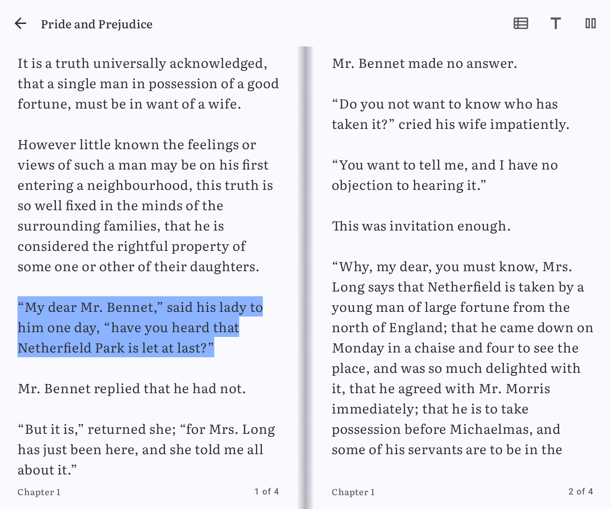

# Ebooks

Pageturner also reads EPUB and PDF books, and can read them aloud.

## Adding ebooks

Put `.epub` or `.pdf` files in any folder you added under **Settings > Book folders**. A folder can hold only ebooks, only
audiobooks, or both. Pageturner finds them when it scans your library, with their cover, title and author, and puts them next
to your audiobooks: in **Current** while you read them, **Not started yet** before you open them, and **Completed** once you
reach the end. A small book badge on the cover tells ebooks and audiobooks apart.

Long-press an ebook to:

- mark it **Not started**, **Current** or **Finished**,
- **Rename** it,
- set a **Cover from the Internet** (searched by title and author) or a **Cover from the file system**,
- **Remove from library**. The file stays on your phone.

## Reading

Tap an ebook to open it where you left off.

- **Turning pages:** drag from the right edge and the page corner curls over like paper, following your finger. Drag from the
  left to bring the previous page back. A tap on the outer third of the screen, the volume keys, the page and arrow keys
  of a keyboard or a Bluetooth page turner turn a page too. What each tap does can be changed under **Controls**.
- **Two pages:** on an unfolded foldable, a tablet or a phone on its side, the book opens to two pages side by side. The right
  page curls over the spine and shows the next page on its back. Your place stays the same when you fold or unfold.
- **Full screen:** tap the middle of the page to hide or show the bars.
- **Page bar:** drag the slider at the bottom to jump anywhere in the book. It shows the chapter and page while you drag, and how
  far you are: the page of the chapter, the chapter and the book in percent, the pages left in each, and about how long they
  take you to read. It also shows the book's length in standard pages of 1,024 characters, an estimate that's the same on
  every screen.
- **Contents:** jump to any chapter, and see your bookmarks and highlights in their own tabs.

### Display

The **Display** button holds:

- **Theme:** Auto, Day, Sepia, Night, Black, Soft paper, Slate, Custom or By time.
- **Colors and themes**, see below.
- **Font:** Serif, Sans, Mono, Atkinson Hyperlegible (made for easy reading) or OpenDyslexic. **Add font** picks a .ttf or
  .otf file from your phone; Pageturner keeps a copy, and the font is listed with the others from then on.
- **Text size:** the slider, or minus and plus for one step at a time.
- **Line spacing**, **Font weight**, **Letter spacing**, **Space between paragraphs** and **First-line indent**.
- **Alignment:** Left, Center, Right or Justified.
- **Hyphenate words** splits long words at the end of a line, by your phone's language.
- **Ligatures** joins letter pairs like fi as in printed books; turn it off to keep every letter apart.
- **Reset text settings** puts all of these back to how they were at first.
- **Brightness**, just for the reader, or the system setting.
- **Controls**, see below.
- **Reading mode:** **Pages** to turn, or **Scroll** to read the book as one long text from top to bottom, see below.
- **Page turn:** the page curls over like paper, slides sideways, or the next one shows at once. Only for pages.
- **Time per page**, for turning pages by themselves, from 10 seconds to 2 minutes.
- **Scrolling** and **Scrolling speed**, in the scroll mode, see below.
- **New book engine (beta)**, for EPUB books, see below.

Under **Layout**:

- **Pages:** Auto shows two pages side by side on wide screens, or always **One page** or **Two pages**. Not in the scroll
  mode.
- **Margins** at the sides, **Top margin** and **Bottom margin**, and the **Space between pages** when two show side by
  side.
- **Shorter lines on wide screens** keeps lines to about 65 characters on tablets and unfolded phones.
- **Orientation:** Auto turns with your phone, **Portrait** and **Landscape** keep the screen that way while you read.

Under **Progress**:

- **Show progress:** **On tap** shows the page bar when you tap the middle of the page. **Always** adds a thin line along the
  bottom of the page as well. **Never** hides both, and the page number at the bottom of the page.
- **Progress bar:** a thin **Line**, a **Bar**, or **Chapters**, which splits the bar into one part per chapter.
- **Page footer:** what the bottom of each page shows next to the chapter: the **Page** of the book, the page of the
  **Chapter**, the **Percent** read, the **Time left** or the **Pages left** in the chapter, or **Nothing**.
- **Show the time** and **Show the battery** add the clock and the battery level to the bottom of the page.
- **Page header:** a line at the top of each page with the book's **Title** or the **Chapter**, or **Nothing**.
- **Show chapters, bookmarks and highlights on the bar** draws small marks where each chapter starts and where your bookmarks
  and highlights are.

### Scrolling and reading hands-free

With **Reading mode** set to **Scroll**, the book is one long text you scroll up and down, chapter after chapter, and a PDF
is one long column of its pages. The page bar, the page footer, bookmarks, highlights, search, contents and reading aloud
work as with pages; reading aloud scrolls along when the passage it reads leaves the screen.

- **Scrolling:** **Smooth** glides, **Instant** moves at once, and **By screen** ends every swipe on the next or previous
  screen, like a page. A tap on the left or right third of the screen or the volume keys move one screen less a line, so
  the last line you read stays in sight.
- **Scroll automatically**, the button in the top bar, scrolls the text slowly by itself at the **Scrolling speed**. It
  waits while your finger is on the screen, while text is selected, a sheet or the bars are open, or the book is read
  aloud, and goes on once they're gone. Tap the button again to stop.
- With pages, the same button is **Turn pages automatically**: the next page comes after the **Time per page**. It waits
  while the bars or a sheet are open or the book is read aloud, and turning a page yourself starts the time anew.

### Colors and themes

**Colors and themes**, under the themes in **Display**, holds:

- **Custom:** pick the **Background**, **Text** and **Selection** colors, and in the new book engine the **Links** color.
  Tap a color to pick from a few to start with, with **Hue**, **Saturation** and **Brightness** sliders, or type its
  **HEX code**. Changing a color switches to the Custom theme, starting from the colors on screen. Links and selection can
  stay **Auto**, the theme's own.
- **Text contrast** shows how well the text stands out from the page, like 12.6:1, and warns below 4.5:1.
- **Images on dark pages:** **Original**, **Dimmed** or **Inverted**, for pictures in the new book engine and for PDF pages.
  Light pages always show them as they are.
- **Paper texture** lays a fine grain like paper under the text, from none to strong.
- **Day and night:** **Switch themes by the time of day** uses one theme **By day** and another **At night**, from **Night
  starts** to **Night ends** in steps of half an hour. The **By time** theme in **Display** turns it on too.
- **Highlights:** give the four highlight colors your own names, like Important, Question or Quote. The names show in the
  selection menu and the highlight sheet. **Highlight strength** makes them lighter or stronger.
- **Saved themes:** **Save these colors** keeps the colors on screen as a theme. Tap a saved theme to use it, or open its
  menu to **Rename**, **Duplicate** or **Delete** it. **Export** writes all saved themes to a file, and **Import** adds the
  themes from such a file.

The time left comes from how fast you read. Pageturner measures it as you turn pages, leaves out pauses of more than two
minutes and jumps, and keeps an average of your last hour of reading across all books. Until it knows you, it guesses about
1,200 characters a minute.

### Controls

**Controls**, next to **Colors and themes** in **Display**, holds:

- **Taps:** what a tap on the left, in the middle and on the right of the page does: **Previous page**, **Next page**,
  **Show or hide bars** or **Nothing**. **Left-handed** swaps the left and the right side. In the scroll mode, the sides
  move a screen instead of a page.
- **Double tap:** **Nothing**, **Show or hide bars** or **Bookmark** the page. With a double tap set, a single tap waits a
  moment to tell them apart. Long-press still selects text.
- **Keys and mouse:** **Turn pages with the volume keys**, on or off. Page Up and Page Down, the arrow keys, the space bar
  (Shift and space goes back) and Bluetooth page turners, which send these keys, always turn pages. **Ctrl+F** searches,
  **Ctrl+B** bookmarks the page, **Ctrl+D** opens **Display** and **Esc** goes back. Keys can't be changed.
- **Mouse wheel:** **Scroll** as usual, or **Turn pages**, one page for each step of the wheel. In the scroll mode, a step
  moves a screen.
- **Buttons:** pick which buttons the top bar shows, and move them up or down to change their order. **Display** always
  stays, it's the way back here. **Buttons at the bottom** puts them in a bar at the bottom of the screen, within reach of
  your thumb.
- **Size of bars and menus** makes the bars, the page bar and these sheets larger or smaller, without changing the
  book's text.
- **Keep the screen on:** **System** turns the screen off like the rest of your phone. **While reading** keeps it on as
  long as the book is open. **Until idle** keeps it on until you haven't touched the screen for 5, 10 or 30 minutes, and
  always while the book is read aloud or turns by itself.
- **Accidental touches:** **Shortest swipe to turn a page** lets shorter swipes fall back. **Ignore touches at the edges**
  leaves out touches that start close to the left or right edge, like a palm holding the phone. **Ask before jumping over
  more than** 10, 50 or 100 pages on the page bar asks "Go to page 120?" first.

### PDF pages

Pinch to zoom into a PDF page and drag to move around it. Double-tap to switch between the whole page and its full width.
While a page is zoomed in, dragging moves the page instead of turning it.

### Bookmarks, highlights and notes

- Tap the bookmark button to bookmark the page.
- Long-press a word to select it and drag to select more. Pick one of four highlight colors, add a **Note**, or **Look up** the
  word in your dictionary or translation app.
- Tap a highlight to change its color, edit its note or delete it.

### Search

Tap the search button and type at least two letters. Every match is listed with its chapter and the text around it; tap one to
jump there.

## Reading aloud

Tap the speaker button and pick a voice:

- **Natural voice** sounds like a person reading. It runs on your phone, so it works offline, and it's downloaded once, about
  130 MB. Choose from several voices: American (Heart, Bella, Michael and more) and British (Emma, Isabella, George, Fable), plus
  voices for Spanish, French, Hindi, Italian, Japanese, Portuguese and Chinese.
- **Phone voice** is your phone's text-to-speech voice. It's used for other languages.

Set the speed, then tap **Start reading**. Pageturner reads a sentence or two at a time, turns the pages as it reads and
highlights the passage it's reading. Turning a page yourself, jumping elsewhere, tapping the button again or leaving the book
stops it. While it reads, the volume keys change the volume instead of turning pages.

## New book engine (beta)

Turn on **New book engine (beta)** under **Display** to show EPUB books the way they were made: with their pictures, headings,
bold and italic text, tables, links and footnotes. It's built on [Readium](https://readium.org).

- Your theme, font, text size, spacing and margins carry over. Hyphenation follows the book's language.
- Link and selection colors and **Highlight strength** take a moment to show, as the pages are made anew. Readium has no
  separate heading color, so headings keep the book's own or the text color.
- **Book's own style** keeps the fonts and formatting the book came with, like its headings, drop caps and spacing. Only the
  text size and colors still change.
- **Word spacing** is only here. Alignment has no **Center**, and **Ligatures** only changes Arabic script.
- The font list also has **Literata**, the serif the app uses for the books' words.
- Until you change them, alignment, hyphenation and the spacing settings leave the book's own.
- Tap the left or right side, swipe or use the volume keys to turn the page, and tap the middle to show or hide the bars.
  The taps, keys, mouse wheel and the rest of **Controls** work the same. **Shortest swipe** only applies with the curl or
  no animation, as Readium slides the pages itself.
- The page bar counts the book in pages that stay the same whatever the screen or text size, and jumps anywhere.
- When the book lists the pages of its printed edition, the page bar shows the **Print page** you're on. Where a printed page
  starts is placed by the book's text, so it can be off by a screen.
- **Count only the main text**, under **Progress**, leaves the front and back matter, like the title page or the index, out
  of the book's percentage, pages left and time left. It uses the landmarks the book marks itself, so it changes nothing for
  books without them.
- With **Show progress** set to **Always**, the bottom of the page shows the chapter, the **Page footer** and the thin line.
- Contents, bookmarks and search work as usual. Links to websites open in your browser.
- Long-press a word and drag to select more, then pick a highlight color, **Note** or **Look up** from the menu. Tap a
  highlight to change its color, edit its note or delete it.
- Reading aloud works with the natural voice and the phone voice, and highlights the passage it's reading.
- The pages curl, slide or turn at once, as set under **Page turn**. On two pages side by side, the whole spread curls over
  as one page.
- In the scroll mode, each chapter scrolls on its own: at its end, swipe sideways, tap the side or press a volume key to
  go on to the next one. Scrolling automatically goes on to the next chapter by itself. **By screen** isn't there, so a
  swipe scrolls freely. Books with fixed pages keep turning their pages.
- Bookmarks and highlights made with one engine don't show in the other.
- The new engine keeps its own place in the book. When you first turn it on, it opens about where you were.

## Good to know

- Without the new book engine, EPUB books show their text only. Pictures and text styling, like bold or headings, are left
  out, and so are print page numbers and **Count only the main text**. See the [reader plan](reader-plan.md).
- PDF books show their pages without chapters or reading time.
- PDF pages show exactly as they're printed. Searching or reading a PDF aloud needs Android 15 or newer, and a PDF made of
  scanned pages has no text. Highlights work in EPUB books only.
- The natural voice needs a 64-bit phone, which nearly every phone from the last years is. On older phones it may pause briefly
  between sentences.
- Reading aloud stops when you leave the book. It has no controls on the lock screen yet.
