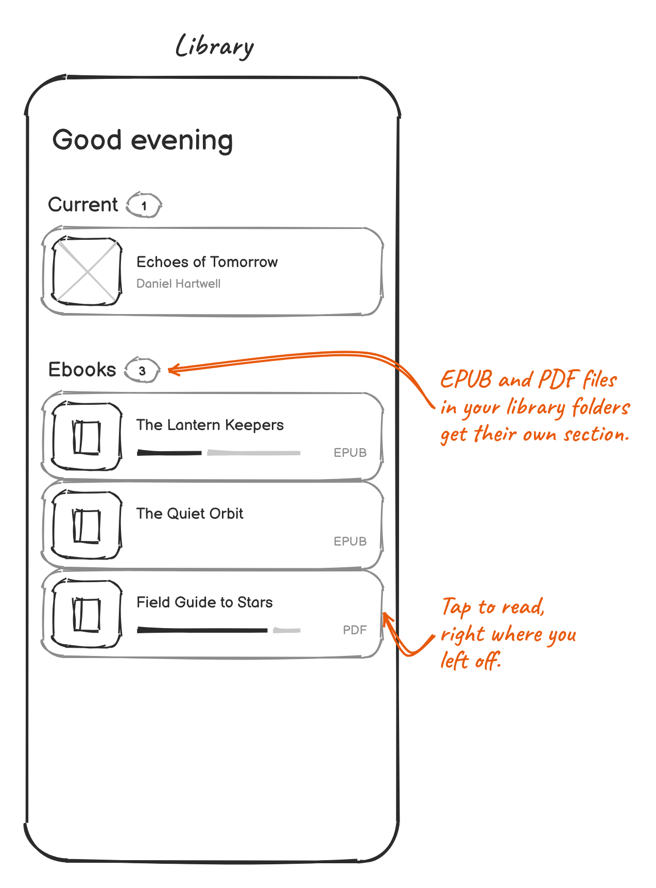

# Ebooks

Pageturner also reads EPUB and PDF books, and can read them aloud.

## Adding ebooks

Put `.epub` or `.pdf` files anywhere in your audiobook folders. Pageturner finds them when it scans your library and lists them in
their own **Ebooks** section, with how far you've read. It doesn't matter how the folder is organized: an ebook next to the
audiobook of the same story shows up too.

## Reading

Tap an ebook to open it where you left off. Swipe, or tap near the left or right edge, to turn a page.

On a foldable, the book follows the screen. Folded, you see one page. Unfolded, the book opens to two pages side by side, like
a paper book. The same happens on a tablet or a phone turned on its side. Your place stays the same when you fold or unfold.

## Reading aloud

Tap the speaker button to have the book read aloud with your phone's text-to-speech voice. Pageturner turns the pages as it reads
and keeps going when you fold or unfold. Turning a page yourself, tapping the button again or leaving the book stops it.

## Good to know

- EPUB books show their text. Pictures and text styling, like bold or headings, are left out.
- PDF pages show exactly as they're printed. Reading a PDF aloud needs Android 15 or newer, and a PDF made of scanned pages
  has no text to read.
- Reading aloud stops when you leave the book. It has no controls on the lock screen yet.
