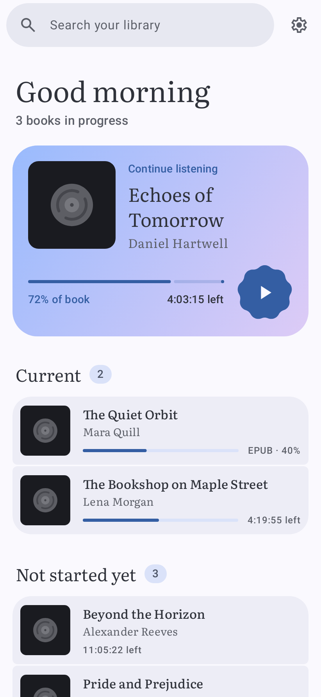
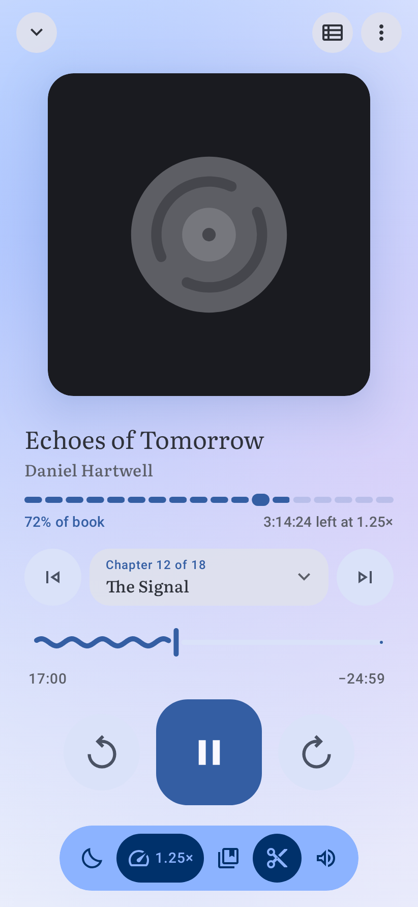
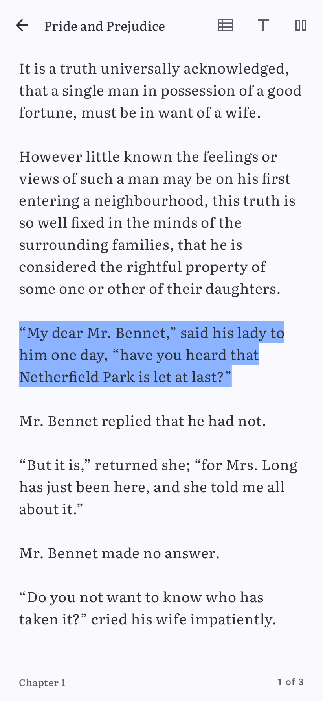

---
hide:
  - toc
---

# Pageturner

An audiobook player and ebook reader for Android.

Pageturner plays your audiobook files, with resume positions, bookmarks, a sleep timer, playback speed, skip silence
and Android Auto. It reads your EPUB, PDF and Kindle books, with two pages side by side on an unfolded foldable. It
reads them aloud in a natural voice, and downloads books from OPDS catalogs, Komga and Audiobookshelf.

## Download

[:material-download: &nbsp;Download Pageturner](https://frankt86.github.io/Pageturner/pageturner.apk){ .md-button .md-button--primary }
[:material-github: &nbsp;GitHub Releases](https://github.com/frankt86/Pageturner/releases/latest){ .md-button }

- **[pageturner.apk](https://frankt86.github.io/Pageturner/pageturner.apk)** is the latest stable release, signed with
  the release key. It is the same file as on the
  [GitHub Releases page](https://github.com/frankt86/Pageturner/releases/latest).
- **[Obtainium](https://obtainium.imranr.dev/)** gets each update for you. Add
  `https://github.com/frankt86/Pageturner` as the app source.
- **[pageturner-debug.apk](https://frankt86.github.io/Pageturner/pageturner-debug.apk)** is the test build. It comes
  from every change to the code, and it can have bugs.

The stable app (`io.github.frankt86.pageturner`) and the test app are two different apps. They install side by side,
and next to Voice from Google Play or F-Droid. Each one keeps its own library and settings.

Do you install an app from outside Google Play for the first time? See [Install](install.md) for the steps.

  
  
  

## Why Pageturner?

- :material-feather:{ .lg .middle } **Clean by design**

  ---

  Each screen shows what you need to listen or read. The rest is one tap away.

- :material-shield-check:{ .lg .middle } **Open source and private**

  ---

  Open source under the GPL. No account, no ads and no analytics. See the [Privacy Policy](privacy-policy.md).

- :material-bookmark-music:{ .lg .middle } **Built for audiobooks**

  ---

  Chapters, a sleep timer with fade-out, bookmarks, playback speed and resume where you stopped. See
  [Organizing Audiobooks](organizing.md).

- :material-book-open-page-variant:{ .lg .middle } **Ebooks too**

  ---

  EPUB, PDF and Kindle books from your folders, with a page curl, themes, fonts, bookmarks, highlights, search and a
  natural read-aloud voice that works offline. See [Ebooks and the Reader](ebooks.md).

- :material-bookshelf:{ .lg .middle } **Catalogs and servers**

  ---

  Download ebooks and audiobooks from free catalogs, Calibre-Web, Komga and other [OPDS catalogs](opds.md), with your
  reading progress in sync with Komga. Stream and download from [Audiobookshelf](audiobookshelf.md).

- :material-update:{ .lg .middle } **Based on Voice**

  ---

  Pageturner is a fork of [Voice](https://github.com/PaulWoitaschek/Voice), the audiobook player by Paul Woitaschek,
  and merges its updates.

## Learn more

- [Install](install.md): download, install and update the app.
- [Organizing Audiobooks](organizing.md): set up your library.
- [Ebooks and the Reader](ebooks.md): read EPUB, PDF and Kindle books, and have them read aloud.
- [Ebook catalogs](opds.md): download books from free catalogs and your own server.
- [Audiobookshelf](audiobookshelf.md): play the books of your audiobook server.
- [FAQ](faq.md): common questions.

Do you want to contribute? See [Development](development.md) and [Architecture](architecture.md).
