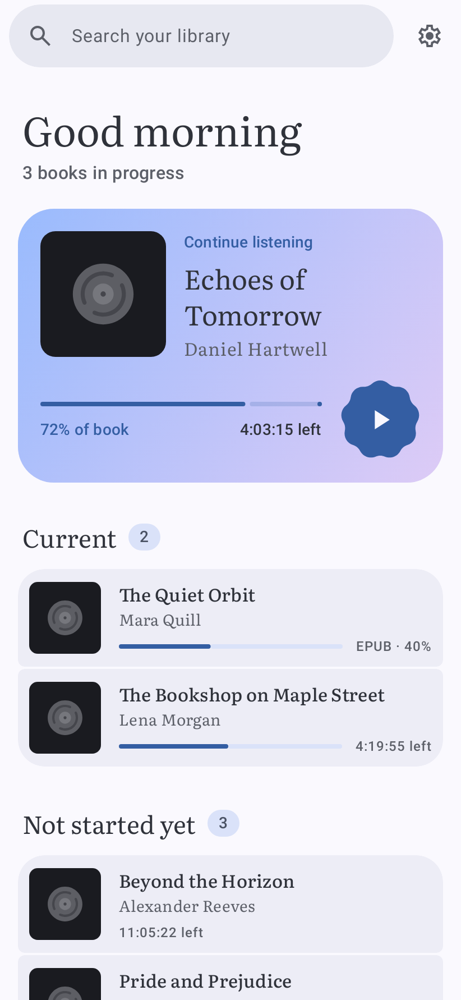
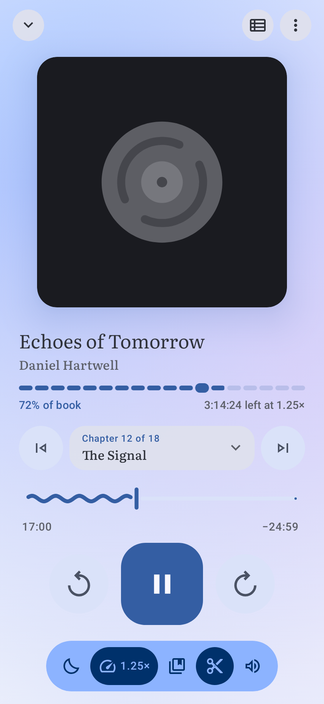
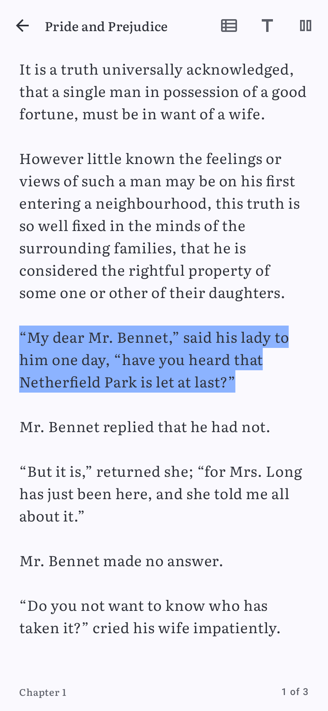

---
hide:
  - toc
---

# Pageturner

A clean audiobook player and ebook reader for Android, based on [Voice](https://github.com/PaulWoitaschek/Voice).

Pageturner turns your own audiobook files into a calm listening library with resume positions, bookmarks, sleep timer, playback speed, silence
skipping, and Android Auto support. It also reads your EPUB and PDF books, two pages side by side on an unfolded foldable,
reads them aloud in a natural voice, and downloads books from OPDS catalogs, Komga and Audiobookshelf.

[:material-download: &nbsp;Download Pageturner](https://frankt86.github.io/Pageturner/pageturner.apk){ .md-button .md-button--primary }

New to installing apps from outside Google Play? See [Install](install.md).

  
  
  

## Why Pageturner?

- :material-feather:{ .lg .middle } **Clean by design**

  ---

  Each screen shows what you need while listening, and the rest is one tap away. No clutter and no upsells.

- :material-shield-check:{ .lg .middle } **Open source & private**

  ---

  Fully open source under the GPL. No account, no ads, no forced cloud sync.

- :material-bookmark-music:{ .lg .middle } **Built for audiobooks**

  ---

  Chapter navigation, sleep timer fade-out, bookmarks, speed control, and resume-where-you-left-off.

- :material-book-open-page-variant:{ .lg .middle } **Ebooks too**

  ---

  EPUB and PDF books from your folders with a real page curl, themes, fonts, bookmarks, highlights, search and a natural read-aloud voice that works offline. One page folded, two pages unfolded. See [Ebooks](ebooks.md).

- :material-bookshelf:{ .lg .middle } **Your servers**

  ---

  Download ebooks and audiobooks from Calibre-Web, Komga and other [OPDS catalogs](opds.md), with your reading progress in step with Komga. Stream and download from [Audiobookshelf](audiobookshelf.md).

- :material-update:{ .lg .middle } **Kept up to date**

  ---

  Pageturner keeps merging the updates of [Voice](https://github.com/PaulWoitaschek/Voice), the audiobook player it's built on.

## Learn more

Read [Organizing Audiobooks](organizing.md) for setting up your library,
[Ebooks](ebooks.md) for reading EPUB and PDF books, [Ebook catalogs](opds.md) for downloading them from your server,
[Audiobookshelf](audiobookshelf.md) for your audiobook server, or the [FAQ](faq.md) for common questions. Want to contribute? See [Development](development.md) and [Architecture](architecture.md).
